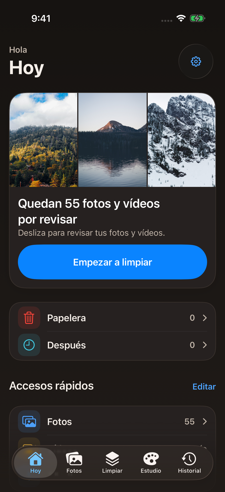
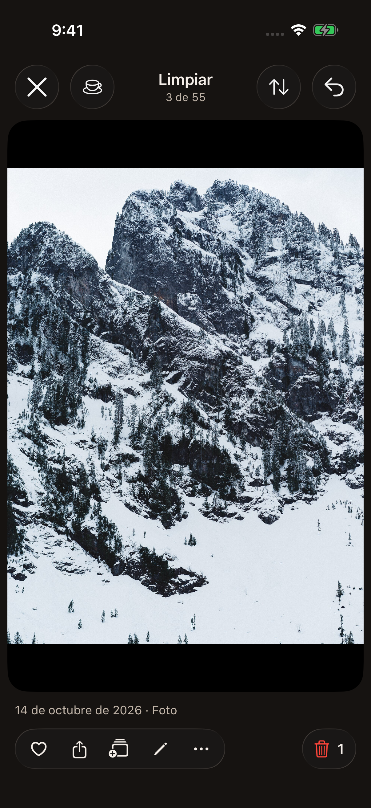
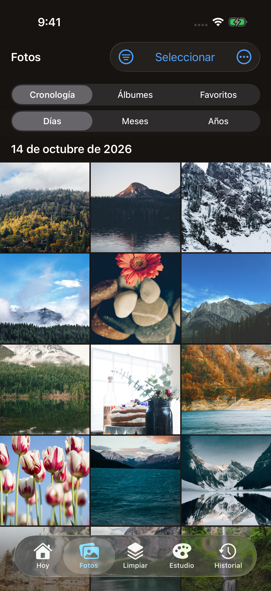
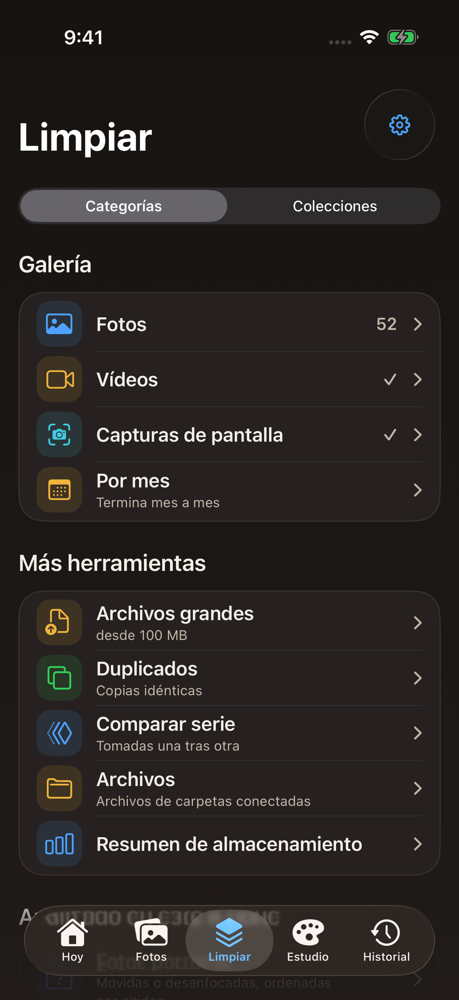
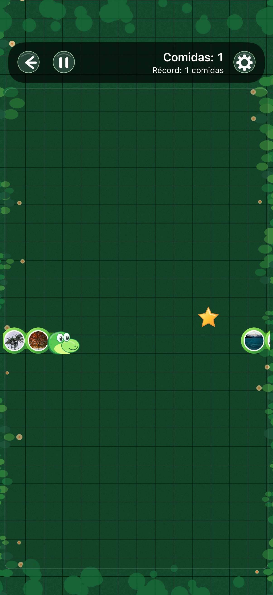
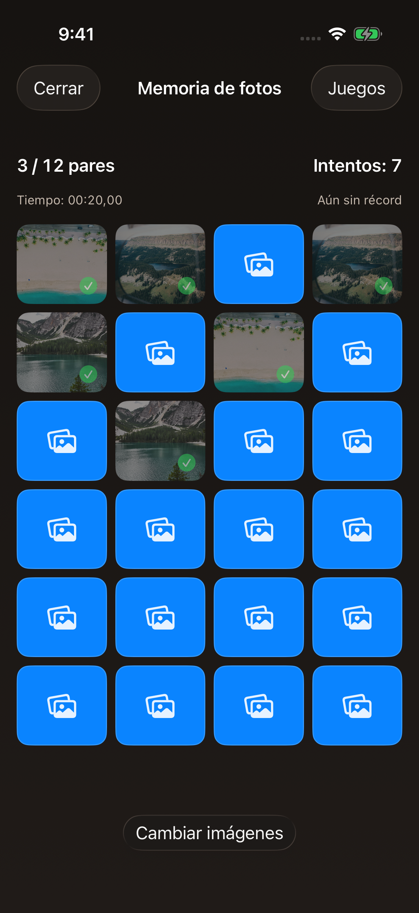
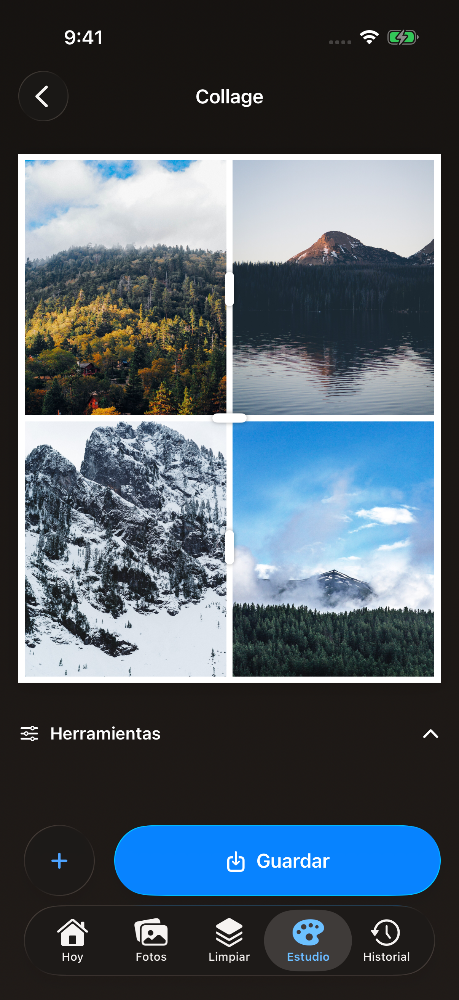
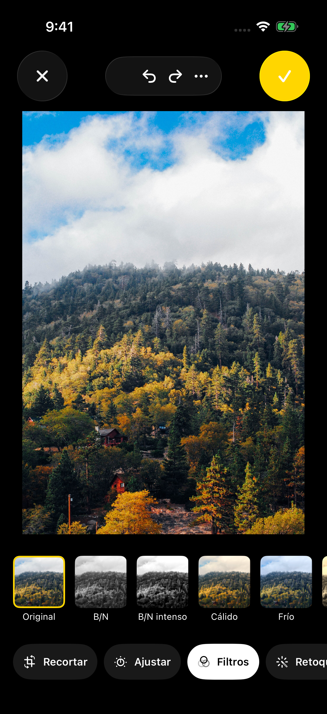
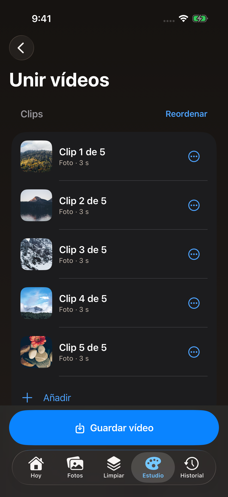
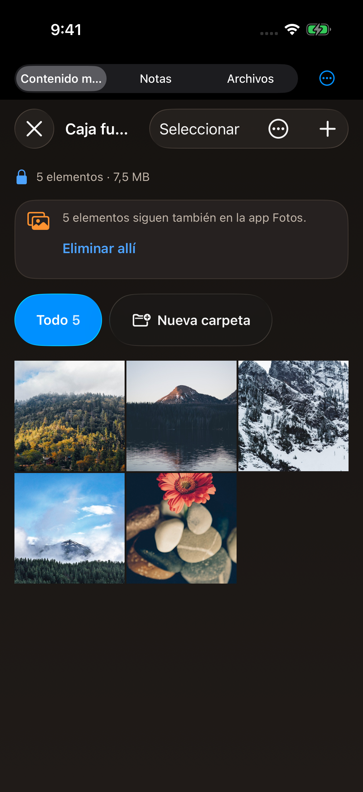

# Spanisch – aktueller Store-Satz

App Store Connect: `es-ES`. Aufnahmen in Dark Mode.

## iPhone 17 Pro

Status: **PASS** · [Native Herkunft und tatsächliche Tests](iphone-medium/provenance.json) · [Sichtprüfung](iphone-medium/review/).

## Drei ausgewählte Store-Videos

## Tresor-Alternative

Apple erlaubt höchstens drei Vorschauen pro Geräteformat/Sprache; die Alternative ersetzt bei Bedarf eines der ausgewählten Videos.

Die Videos passen in das gemeinsame iPhone-Vorschauformat 886 × 1920. Duo ist separat im [Umgebungsbericht](../../DUO_STATUS.json) ausgewiesen.
