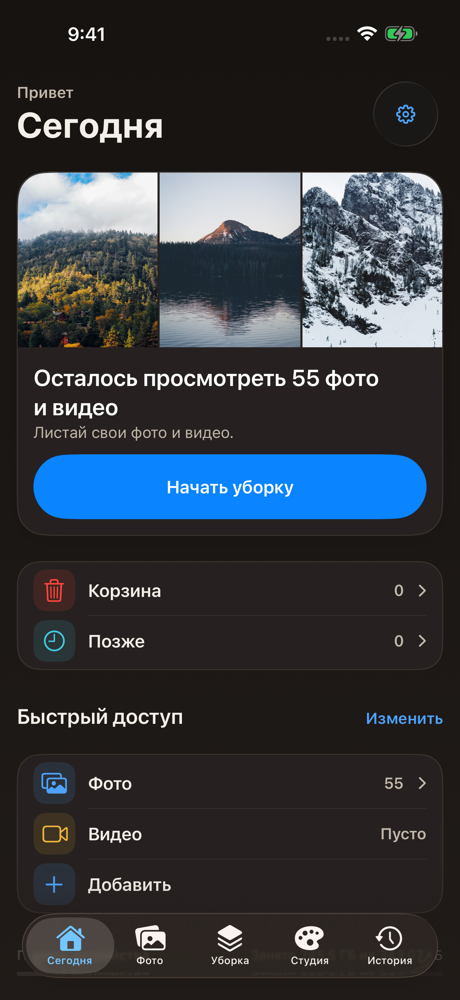
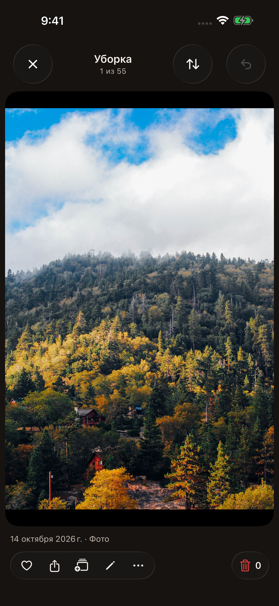
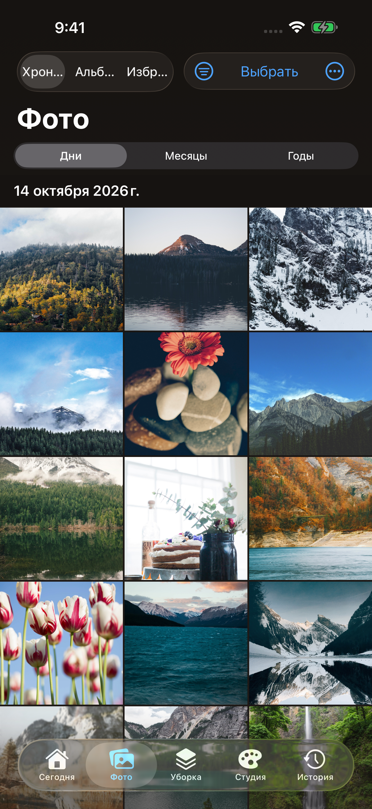
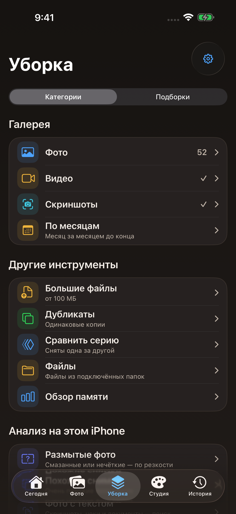
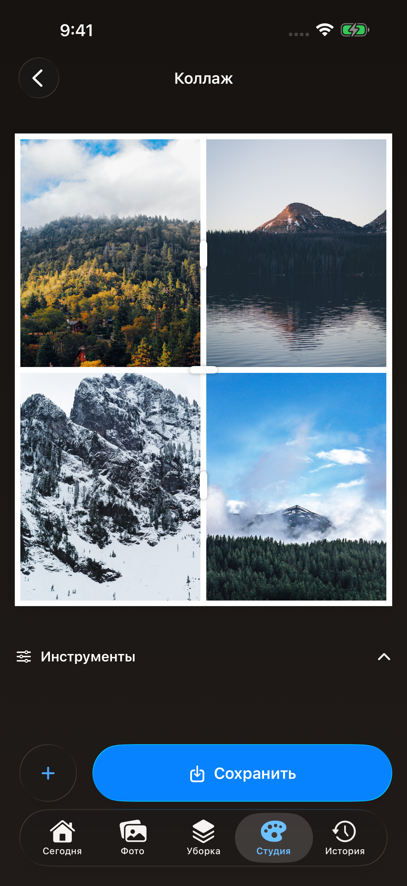
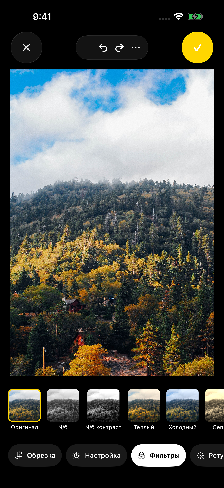
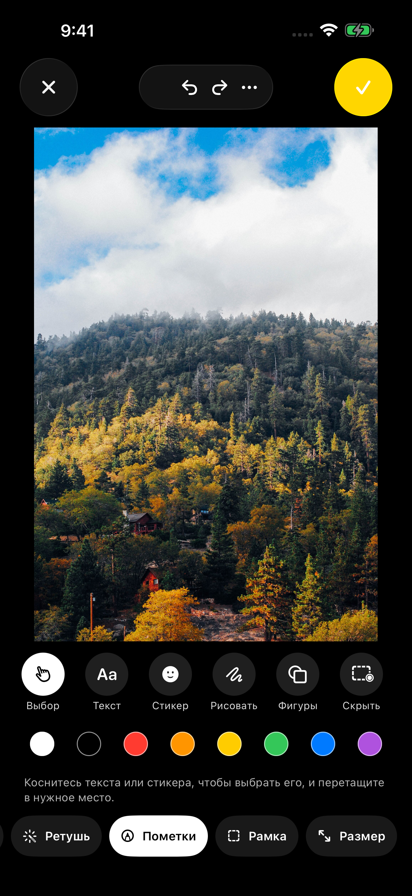
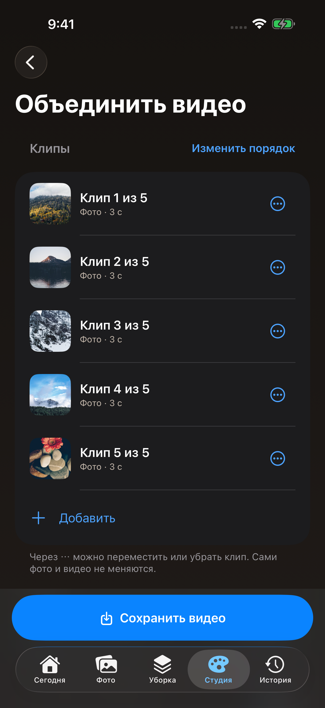
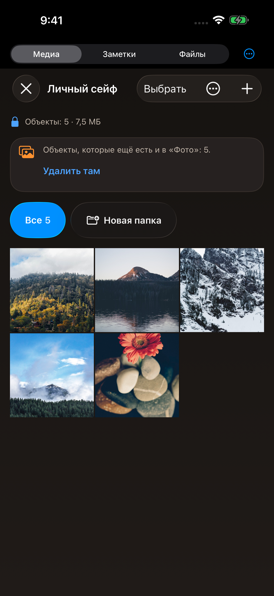
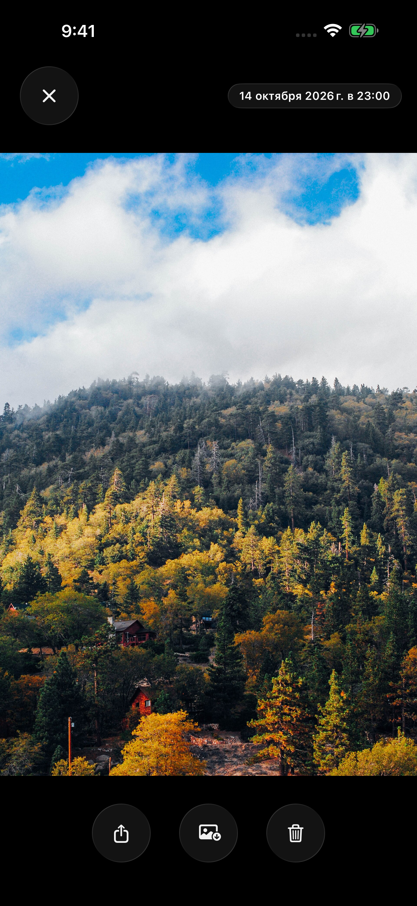

# Russisch – PhotoMaid

App Store Connect: `ru` · Dark Mode · iPhone 17 Pro Max.

123 unveränderte native Seitenaufnahmen, 10 Bilder in der Store-Auswahl, 3 Vorschauvideos. Sichtprüfung: **PASS**.

[Aufnahmelauf 38735332484](https://github.com/mrdevn4ever-sys/PhotoMaid/actions/runs/38735332484) · [Herkunft und Testergebnis](provenance.json) · [Prüfbögen](review/).

## Vorschlag für die Store-Seite

Die Originaldatei öffnet sich beim Anklicken. Apple erlaubt bis zu zehn Screenshots pro Gerätegröße und Lokalisierung.

## Vorschauvideos zur Auswahl

[Video-Aufnahmelauf 38774007322](https://github.com/mrdevn4ever-sys/PhotoMaid/actions/runs/38774007322) · [Native Video-Tests und Bildbestand](preview-provenance.json) · [Format und Poster-Zeitcodes](previews/manifest.json).

- [Aufräumen – Behalten, Papierkorb, Später und Zurück](previews/01-review.mp4) · [Poster](previews/01-review-poster.png)
- [Studio – Anpassen, Filter, Zeichnen und Rahmen](previews/02-studio.mp4) · [Poster](previews/02-studio-poster.png)
- [Tresor – Medien, Betrachter und Zoom](previews/03-vault.mp4) · [Poster](previews/03-vault-poster.png)

## Vollständiges Seitenarchiv

### Einführung

[introduction-01](all-pages/01-introduction/introduction-01.png) · [introduction-02](all-pages/01-introduction/introduction-02.png) · [introduction-03](all-pages/01-introduction/introduction-03.png) · [introduction-04](all-pages/01-introduction/introduction-04.png) · [introduction-05](all-pages/01-introduction/introduction-05.png)

### Heute und Feed

[feed-gesture-guide](all-pages/02-today-and-review/feed-gesture-guide.png) · [feed-later](all-pages/02-today-and-review/feed-later.png) · [feed-menu](all-pages/02-today-and-review/feed-menu.png) · [feed](all-pages/02-today-and-review/feed.png) · [today](all-pages/02-today-and-review/today.png)

### Fotos

[album](all-pages/03-photos/album.png) · [albums](all-pages/03-photos/albums.png) · [favorites](all-pages/03-photos/favorites.png) · [grid](all-pages/03-photos/grid.png) · [hidden](all-pages/03-photos/hidden.png) · [library-favorites](all-pages/03-photos/library-favorites.png) · [library-photos](all-pages/03-photos/library-photos.png) · [library-screenshots](all-pages/03-photos/library-screenshots.png) · [library-videos](all-pages/03-photos/library-videos.png) · [library](all-pages/03-photos/library.png) · [search](all-pages/03-photos/search.png) · [selection](all-pages/03-photos/selection.png) · [slideshow-settings](all-pages/03-photos/slideshow-settings.png) · [slideshow](all-pages/03-photos/slideshow.png) · [tags](all-pages/03-photos/tags.png) · [viewer-album-picker](all-pages/03-photos/viewer-album-picker.png) · [viewer-info](all-pages/03-photos/viewer-info.png) · [viewer](all-pages/03-photos/viewer.png)

### Aufräumen

[blurry-progress](all-pages/04-cleanup/blurry-progress.png) · [blurry-results-grid](all-pages/04-cleanup/blurry-results-grid.png) · [blurry-results](all-pages/04-cleanup/blurry-results.png) · [blurry](all-pages/04-cleanup/blurry.png) · [categories-progress](all-pages/04-cleanup/categories-progress.png) · [categories-results-grid](all-pages/04-cleanup/categories-results-grid.png) · [categories-results](all-pages/04-cleanup/categories-results.png) · [categories](all-pages/04-cleanup/categories.png) · [cleanup-bottom](all-pages/04-cleanup/cleanup-bottom.png) · [cleanup](all-pages/04-cleanup/cleanup.png) · [collections-bottom](all-pages/04-cleanup/collections-bottom.png) · [collections](all-pages/04-cleanup/collections.png) · [documents-progress](all-pages/04-cleanup/documents-progress.png) · [documents-results-grid](all-pages/04-cleanup/documents-results-grid.png) · [documents-results](all-pages/04-cleanup/documents-results.png) · [documents](all-pages/04-cleanup/documents.png) · [duplicates](all-pages/04-cleanup/duplicates.png) · [files](all-pages/04-cleanup/files.png) · [large-files](all-pages/04-cleanup/large-files.png) · [later](all-pages/04-cleanup/later.png) · [months](all-pages/04-cleanup/months.png) · [series](all-pages/04-cleanup/series.png) · [similar-progress](all-pages/04-cleanup/similar-progress.png) · [similar-results-grid](all-pages/04-cleanup/similar-results-grid.png) · [similar-results](all-pages/04-cleanup/similar-results.png) · [similar](all-pages/04-cleanup/similar.png) · [storage-bottom](all-pages/04-cleanup/storage-bottom.png) · [storage](all-pages/04-cleanup/storage.png) · [trash](all-pages/04-cleanup/trash.png)

### Studio

[archive-bottom](all-pages/05-studio/archive-bottom.png) · [archive](all-pages/05-studio/archive.png) · [collage-save-options](all-pages/05-studio/collage-save-options.png) · [collage](all-pages/05-studio/collage.png) · [editor-adjust](all-pages/05-studio/editor-adjust.png) · [editor-crop](all-pages/05-studio/editor-crop.png) · [editor-filter](all-pages/05-studio/editor-filter.png) · [editor-frame](all-pages/05-studio/editor-frame.png) · [editor-markup](all-pages/05-studio/editor-markup.png) · [editor-resize](all-pages/05-studio/editor-resize.png) · [editor-retouch](all-pages/05-studio/editor-retouch.png) · [editor-save-options](all-pages/05-studio/editor-save-options.png) · [editor](all-pages/05-studio/editor.png) · [edits](all-pages/05-studio/edits.png) · [movie-bottom](all-pages/05-studio/movie-bottom.png) · [movie](all-pages/05-studio/movie.png) · [pdf-bottom](all-pages/05-studio/pdf-bottom.png) · [pdf-studio](all-pages/05-studio/pdf-studio.png) · [pdf](all-pages/05-studio/pdf.png) · [received](all-pages/05-studio/received.png) · [studio-bottom](all-pages/05-studio/studio-bottom.png) · [studio](all-pages/05-studio/studio.png) · [tools-batchEdit-bottom](all-pages/05-studio/tools-batchEdit-bottom.png) · [tools-batchEdit](all-pages/05-studio/tools-batchEdit.png) · [tools-convert-bottom](all-pages/05-studio/tools-convert-bottom.png) · [tools-convert](all-pages/05-studio/tools-convert.png) · [tools-gif-bottom](all-pages/05-studio/tools-gif-bottom.png) · [tools-gif](all-pages/05-studio/tools-gif.png) · [tools-removeLocation-bottom](all-pages/05-studio/tools-removeLocation-bottom.png) · [tools-removeLocation](all-pages/05-studio/tools-removeLocation.png) · [tools-resize-bottom](all-pages/05-studio/tools-resize-bottom.png) · [tools-resize](all-pages/05-studio/tools-resize.png) · [tools-stitch-bottom](all-pages/05-studio/tools-stitch-bottom.png) · [tools-stitch](all-pages/05-studio/tools-stitch.png) · [workflow-editor](all-pages/05-studio/workflow-editor.png) · [workflows-bottom](all-pages/05-studio/workflows-bottom.png) · [workflows](all-pages/05-studio/workflows.png)

### Tresor

[vault-change-code-empty](all-pages/06-vault/vault-change-code-empty.png) · [vault-files](all-pages/06-vault/vault-files.png) · [vault-media-before-details](all-pages/06-vault/vault-media-before-details.png) · [vault-media-picker](all-pages/06-vault/vault-media-picker.png) · [vault-media](all-pages/06-vault/vault-media.png) · [vault-note-editor](all-pages/06-vault/vault-note-editor.png) · [vault-notes-with-note](all-pages/06-vault/vault-notes-with-note.png) · [vault-notes](all-pages/06-vault/vault-notes.png) · [vault-settings](all-pages/06-vault/vault-settings.png) · [vault-setup-code-empty](all-pages/06-vault/vault-setup-code-empty.png) · [vault-setup-entry](all-pages/06-vault/vault-setup-entry.png) · [vault-setup-introduction](all-pages/06-vault/vault-setup-introduction.png) · [vault-tools](all-pages/06-vault/vault-tools.png) · [vault-trash](all-pages/06-vault/vault-trash.png) · [vault-viewer](all-pages/06-vault/vault-viewer.png)

### Einstellungen und Pro

[backup-bottom](all-pages/07-settings/backup-bottom.png) · [backup](all-pages/07-settings/backup.png) · [controls-bottom](all-pages/07-settings/controls-bottom.png) · [controls](all-pages/07-settings/controls.png) · [excluded-albums](all-pages/07-settings/excluded-albums.png) · [help-bottom](all-pages/07-settings/help-bottom.png) · [help](all-pages/07-settings/help.png) · [privacy-bottom](all-pages/07-settings/privacy-bottom.png) · [privacy](all-pages/07-settings/privacy.png) · [pro-bottom](all-pages/07-settings/pro-bottom.png) · [pro](all-pages/07-settings/pro.png) · [settings-bottom](all-pages/07-settings/settings-bottom.png) · [settings](all-pages/07-settings/settings.png)

### Verlauf

[history](all-pages/08-history/history.png)

## Grenzen des Bildsatzes

Kamera/Scanner und echtes Face ID brauchen ein physisches iPhone. Videoeditor und Wiedergabe mit echten Videodateien sind mit dem ausschließlich aus Fotos bestehenden Bildsatz nicht aufgenommen; eine echte Filmzusammenstellung aus fünf Fotos ist im Seitenarchiv enthalten. Wiederherstellungsschlüssel werden nicht veröffentlicht. Leere Ansichten bleiben ehrlich leer; Analyseergebnisse stammen aus dem tatsächlichen lokalen Lauf.
